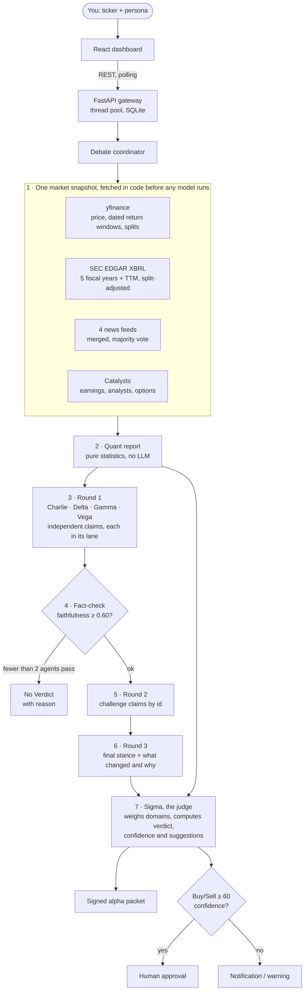

# Kai — The Smart Investor

**An explainable investing copilot.** Kai analyses a US-listed stock with a small committee of AI agents, makes them fact-check each other against the underlying data, and then **computes** the verdict with fixed, auditable rules. The language model argues and explains; it never decides.

> Kai is a research tool. It is not investment advice, and nothing it outputs is a recommendation to buy or sell any security.

- Use cases and walkthroughs: [USECASES.md](USECASES.md)
- Design decisions and rationale: [DESIGN.md](DESIGN.md)
- Test results: [TESTRESULTS.md](TESTRESULTS.md)

---

## Contents

1. [Why Kai](#why-kai)
2. [How it works](#how-it-works)
3. [What you get from one analysis](#what-you-get-from-one-analysis)
4. [Quick start](#quick-start)
5. [Configuration](#configuration)
6. [How the verdict is computed](#how-the-verdict-is-computed)
7. [The quant layer](#the-quant-layer)
8. [Architecture and project layout](#architecture-and-project-layout)
9. [API reference](#api-reference)
10. [Testing](#testing)
11. [Security and privacy](#security-and-privacy)
12. [Limitations](#limitations)
13. [Roadmap](#roadmap)

---

## Why Kai

Most "AI stock analysis" tools hand you a paragraph and a rating, with no way to tell which parts are grounded in data and which were invented. Kai is built around the opposite principle: **code fetches and checks; the model only argues.**

| Common problem | What Kai does instead |
|---|---|
| The model quotes numbers from memory | Every figure an agent states must cite an evidence record, and is **re-computed in code** from the fetched data (1% tolerance). Numbers in a claim's wording are checked too. |
| A single model, a single opinion | Four specialists, each on its own model and locked into its own domain (Charlie: SEC fundamentals, Delta: news, Gamma: valuation and risk, Vega: catalysts and options), state claims, challenge each other's claims **by id**, then revise. The judge, not the agents, weighs the domains. |
| "Confidence" is whatever the model says | Confidence is a formula over the debate score, fact-check results, debate integrity and a quantitative report. |
| The verdict is a paragraph | The verdict is computed from stances, verified claims and persona thresholds, and comes with computed suggestions: what would turn it into Buy or Sell, price levels, upcoming events and risk. The model's explanation cannot change any of it. |
| Failures are hidden | If data is missing, an agent fails, or the fact-check breaks the debate, Kai says **No Verdict** with the reason. It never falls back to the model's own knowledge. |
| Black-box output | Every claim, critique, change of mind, gate and statistic is shown, with its source and sample size. A signed record of the result is stored. |

## How it works



1. **Fetch, from one snapshot.** Market data is fetched first and its time recorded; SEC statements follow, with trailing-twelve-month (TTM) figures and per-share values put on today's share basis using the split history; news and catalysts (next earnings, analyst targets and revisions, options-implied volatility) are priced off the same snapshot. Agents receive numbered evidence records (for example `sec:revenue:FY2026`, `mkt:return_1m` with its exact date range); they do not call tools themselves.
2. **Quant report.** A deterministic statistics module builds a report (volatility, beta, Monte Carlo DCF, forward probabilities, and more) before round 1.
3. **Round 1.** Each agent returns validated JSON, in its own domain only: a stance, a confidence, and claims. Every claim cites evidence.
4. **Circuit breaker.** Every claim is re-checked against the data. An agent below 60% faithfulness is dropped; with fewer than two agents left the debate ends with *No Verdict*.
5. **Round 2.** Each agent challenges or confirms specific claims of the others by id (`charlie.C2`), citing evidence from its own data. A dispute that compares returns over different windows (1 month against 1 year) is rejected in code.
6. **Round 3.** Each agent gives a final stance and answers every critique it received. It may change its stance only when its own claims were disputed with data or failed the fact-check, never because another domain points the other way (that would count that evidence twice).
7. **Judge.** Sigma weighs the four domains, applies the persona's thresholds, computes the confidence (Hold included) and a playbook of suggestions. One model call writes the explanation afterwards.

A full analysis makes thirteen model calls (twelve agent calls plus the explanation, plus a short repair when a reply breaks a rule) under an 80,000-token debate limit divided between the agents. Measured token use per live run is in [TESTRESULTS.md](TESTRESULTS.md).

## What you get from one analysis

- **A verdict with a confidence**: Buy, Hold or Sell, each with a confidence (for Hold: how firmly the debate sits inside the Hold zone), or No Verdict with the reason.
- **Suggestions**: what would turn the verdict into Buy or Sell (score needed, entry price for the required margin of safety), the fair-value range and analyst target, the next earnings date and the options-implied move, and the size of past swings. Every number is computed from the evidence; it is research, not advice.
- **Why**: decision gates with their values, the verified supporting points, and the risks the agents raised.
- **Trust metrics**: *faithfulness* (share of numeric claims that match the data) and *debate integrity* (critiques answered, failed claims corrected).
- **The debate itself**: per agent, every claim with its evidence, verification status, the round-2 challenges and the round-3 changes.
- **A quant report**: ranges and probabilities, each with the sample size behind it and a label for whether it describes the past, follows from stated assumptions, or is a prediction.
- **Persona comparison**: the same debate judged under Zen, Balanced and Alpha thresholds.
- **A signed alpha packet** (Ed25519) containing the verdict, scores, risks and the full quant report, plus a stored debate log and token-use trace.
- **Human-in-the-loop approval** for Buy/Sell signals at or above the confidence threshold.

## Quick start

### Prerequisites

- Python 3.10+ (developed and tested on 3.12)
- Node.js 18+ and npm
- LLM keys: a **Groq** key and a **Google AI (Gemini)** key. Agents are spread across both providers; with only one key, each agent falls back to that provider's model in its chain.
- Internet access (SEC EDGAR, Yahoo Finance, news feeds). Both keys and network are also needed for the test suite, which runs live.

### Install

```bash
git clone https://github.com/Shubham0D4/Kai-The-Smart-Investor.git
cd Kai-The-Smart-Investor

python3 -m venv venv
source venv/bin/activate            # Windows: venv\Scripts\activate
pip install -r requirements.txt

cd kai-frontend && npm install && cd ..
```

### Configure

```bash
cp .env.example .env                # then add GROQ_API_KEY and/or GOOGLE_API_KEY
```

`.env` is gitignored. Keep real keys out of `.env.example`.

### Run

Backend (terminal 1):

```bash
source venv/bin/activate
uvicorn gateway.app:app --port 8080
```

Frontend (terminal 2):

```bash
cd kai-frontend
npm run dev
```

Open **http://localhost:5173**, enter a ticker (for example `AAPL`), choose a persona, and press **Run analysis**. The API documentation is at `http://127.0.0.1:8080/docs`.

### Without the browser

```bash
python -m coordinator.server --ticker AAPL --persona balanced   # one debate, log in debate_logs/
python scripts/simulate_debate.py --ticker NVDA --persona alpha # debate + signed alpha packet
```

## Configuration

### Environment variables

| Variable | Default | Purpose |
|---|---|---|
| `GROQ_API_KEY` | – | Groq key |
| `GOOGLE_API_KEY` | – | Gemini key |
| `NVIDIA_API_KEY` | – | Optional: free last-resort fallback model (NVIDIA `nemotron-3-ultra-550b-a55b` from build.nvidia.com; trial for prototyping, about 40 requests a minute, prompts may be logged). |
| `FINNHUB_API_KEY` | – | Optional: Finnhub company news (free key, 60 calls a minute). Without it that feed is skipped. |
| `KAI_LLM_CONFIG_PATH` | `config/llm.yaml` | Model routing, output caps and token-budget shares (see below) |
| `GATEWAY_HOST` | `127.0.0.1` | Bind address. Change only after adding authentication. |
| `GATEWAY_PORT` | `8080` | Port |
| `GATEWAY_CORS_ORIGINS` | `http://localhost:5173,http://127.0.0.1:5173` | Browser origins allowed to call the API |
| `KAI_DB_URL` | `sqlite:///./kai.db` | Sessions, history and chat |
| `KAI_MAX_CONCURRENT_DEBATES` | `2` | Debates that may run at once |
| `KAI_THRESHOLDS_PATH` | `config/thresholds.yaml` | Alternative thresholds file |
| `AP2_PRIVATE_KEY_PATH` | `ap2_private_key.pem` | Ed25519 signing key; generated on first run if missing |
| `VITE_API_URL` | `http://127.0.0.1:8080` | Backend URL used by the frontend |
| `VITE_FINNHUB_API_KEY` | – | Optional: live trade prices on the ticker page |

### Models and token budget: `config/llm.yaml`

Each agent has its own chain of models, tried in order, so one provider's rate limit or outage does not stall the debate, and the agents are not one model arguing with itself:

| Agent | First choice | Fallback |
|---|---|---|
| Charlie (SEC numbers) | `openai/gpt-oss-120b` (Groq, reasoning low) | `gemini-3.5-flash-lite` |
| Delta (news) | `gemini-3.5-flash-lite` (thinking minimal) | `openai/gpt-oss-20b` |
| Gamma (valuation) | `gemini-3.5-flash-lite` (thinking minimal) | `openai/gpt-oss-120b` |
| Vega (catalysts & options) | `gemini-3.5-flash` (thinking low) | `openai/gpt-oss-20b` |
| Sigma (explanation only) | `openai/gpt-oss-120b` (runs after the debate) | `gemini-3.5-flash` |

The same file sets each call's output cap and divides the 80,000-token debate limit into shares (Charlie 20%, Delta 19%, Gamma 25%, Vega 16%, 20% shared reserve). When every model in a chain is rate-limited or temporarily overloaded, the client waits as long as the provider asks (up to a minute) and tries again. Before every call the prompt is estimated and the output cap lowered to what the agent has left; an agent that cannot afford a useful reply is left out of that step with a warning, so a debate never exceeds the limit. Every chain ends with NVIDIA's hosted `nemotron-3-ultra-550b-a55b` when `NVIDIA_API_KEY` is set. Groq's free tier rejects any request above 8,000 tokens per minute, so before each Groq call the output cap is lowered to fit (`request_token_limits` in the file), and a prompt too big for it goes straight to the next model. On a rate limit (429) the client waits the `retry-after` the provider sends, up to a minute, and asks the same model again before falling through. A reply that fails validation is repaired once; if it still fails, a different model in the chain gets one last try before the agent is dropped. Providers retire model ids; list what your keys can use with `python -m coordinator.llm_client --list` and edit the file.

**Wire protocol.** Agents exchange data in a compact format: one line per evidence record with exact values (`[sec:revenue:FY2026] 478834000000 USD`), compact JSON, and pilot-style fixed phrasing (dispute / qualify / support; kept / revised / withdrawn; word limits on arguments). Replies are constrained by JSON schemas whose enums list the evidence ids and claim refs an agent may use, so citing an id it was not given is impossible rather than retried. A reply that is valid JSON but breaks a rule gets a short repair request, not the whole prompt again. Text shown to users stays plain English.

### Agent prompts: `prompts/`

Each agent's system prompt is a plain file you can edit: `prompts/charlie.md`, `delta.md`, `gamma.md`, `vega.md` and `sigma.md`. Rules shared by the four debaters live in `_lane_rule.md`, `_evidence_rule.md` and `_comms_protocol.md` and are pulled in with `{{include: ...}}`, so a rule edited once applies to all of them. Edits take effect on the next analysis. See [prompts/README.md](prompts/README.md) for what not to change (the JSON format and id formats, which code depends on).

### Decision thresholds: `config/thresholds.yaml`

Every tunable number lives in one validated file, editable by hand. The persona only selects a row here; **it is never given to the agents** and never alters valuation inputs.

| | Buy if score ≥ | and margin of safety ≥ | and volatility ≤ | Sell if score ≤ |
|---|---|---|---|---|
| **Zen** | 0.50 | 25% | 35% | −0.20 |
| **Balanced** | 0.35 | 15% | 50% | −0.30 |
| **Alpha** | 0.25 | 0% | no limit | −0.40 |

The same file sets the judge's domain weights (fundamentals 0.30, valuation 0.30, news 0.20, catalysts 0.20), the fact-check floor (0.60), the minimum number of valid agents (2), the token budget (80,000), the CAPM constants, the Monte Carlo and bootstrap settings, the human-approval threshold (confidence 60) and the quant layer's seed. Zen and Balanced cannot issue a Buy without a computed DCF margin of safety; Alpha can.

## How the verdict is computed

All of this runs in code (`judge/`), not in a model.

```
agent score   s_a = stance (+1 bullish, 0 neutral, −1 bearish) × confidence/100 × faithfulness_a
debate score  S   = weighted average of s_a over the agents that passed the fact-check (−1 … +1),
                    weights = judge.weights (the judge weighs the domains, never the agents)
coverage          = weight of the agents counted ÷ total weight

Buy   if S ≥ buy threshold and margin of safety and volatility gates pass
Sell  if S ≤ sell threshold
Hold  otherwise                       (a blocked Buy is reported with the gate that blocked it)

confidence, Buy/Sell = 100 × |S| × integrity × coverage × Q × C
confidence, Hold     = 100 × hold conviction × integrity × coverage
hold conviction      = distance from S to the nearer Buy/Sell trigger, relative to that trigger
                       (S = 0 → 1; S just under the buy trigger → near 0); when S clears the buy
                       trigger but a gate blocks it: how far the gate missed (a margin of safety
                       of 0.10 against 0.15 is a weak Hold, −22 against 0.15 a firm one)
```

- **Faithfulness** is verified claims ÷ checkable claims (with a floor of three so one easy claim cannot score 100%). Numeric claims are re-computed (`equals`, `growth`, `ratio`, `diff`); quotes must appear in the cited article; inferences must rest on verified claims.
- **Integrity** rewards answering every critique and correcting claims that failed the fact-check. Changing your mind for a stated reason costs nothing; an unexplained flip is penalised.
- **Q (agreement)** lowers confidence when the quant report's probabilities point against the verdict. **C (contradictions)** lowers it when agents' stances conflict with the report. Both can only lower confidence, by at most half each, and never change Buy/Hold/Sell.
- **Suggestions** (`judge/playbook.py`) are computed from the same evidence: the score and entry price that would make it a Buy (DCF value × (1 − required margin of safety)), the score that would make it a Sell, the Monte Carlo fair-value range, the analyst consensus target, the next earnings date and the options-implied move, past one-day losses and drawdown, and where other risk settings disagree.
- **Human approval:** a Buy or Sell at confidence ≥ 60 requires explicit approval. Lower-confidence Buy/Sell is delivered as a visible warning, never as a plain success.

## The quant layer

`quant/` is pure statistics (numpy, scipy, statsmodels): no network and no LLM. Every field carries its value, unit, interval where one exists, and the sample size or simulation count behind it. Missing or too-short inputs produce an explicit **unavailable** with a reason, never a default number. Randomness is seeded and the seed is recorded in the report.

| Group | Contents | Nature |
|---|---|---|
| Return distribution | annualised volatility, skew, kurtosis, max drawdown, historical and normal 1-day VaR (95%) | describes the past (normal VaR: model) |
| Market relationship | beta and its standard error, correlation, regression intercept, CAPM discount rate | describes the past (CAPM rate: model) |
| Monte Carlo DCF | fair-value p10/p50/p90 and the share of simulations above the current price | model: follows from stated assumptions |
| Forward simulation | probability the price is above today's after 63 trading days (block bootstrap and normal), with intervals | prediction; trend removed by default (`drift_mode`) |
| Base rates | share of similar past cases that rose, with Wilson interval | describes the past; "insufficient data" below 30 cases |
| Calibration | Brier score and reliability table of Kai's own past forecasts | describes the past; needs the backtest script |

## Architecture and project layout

```
.
├── agents/            Charlie, Delta, Gamma, Vega + the shared claim schema (pydantic)
├── prompts/           Editable system prompt per agent, plus shared rules
├── coordinator/       Debate orchestration, transcript, LLM client, config loader, debate log
├── judge/             Verifier (claim checks), scoring (verdict), playbook (suggestions), Sigma, AP2 signing
├── quant/             Deterministic statistics and the QuantReport model
├── gateway/           FastAPI app, session store (SQLite), HITL manager, response schemas
├── mcp_server/        Data tools (SEC, market, news, catalysts, finance math); optional MCP adapter
├── config/            thresholds.yaml, llm.yaml
├── scripts/           simulate_debate.py, calibration_backtest.py, write_test_results.py
├── kai-frontend/      React 19 + Vite + Bootstrap 5.3 dashboard
└── tests/             Live test suite (real models, real data); results in TESTRESULTS.md
```

Runtime files (all gitignored): `kai.db` (sessions, history, chat), `debate_logs/` (the persisted transcript of each debate), `alpha_packets/` (signed packets), `*.pem` (signing key).

**Data sources**

| Data | Source |
|---|---|
| Financial statements (5 fiscal years and trailing 12 months: revenue, margins, EPS, cash flow, debt, equity, shares), per-share values split-adjusted | SEC EDGAR XBRL company facts (10-K and 10-Q) |
| Prices, return windows with exact dates, 10-year history, splits, S&P 500, 10-year Treasury yield | Yahoo Finance via `yfinance` |
| Next earnings date and consensus, analyst targets, ratings, upgrades and estimate revisions, option chains (implied volatility and move) | Yahoo Finance via `yfinance` |
| News with summaries | Finnhub company news (needs a free key), Yahoo Finance RSS and Google News RSS, fetched in parallel, de-duplicated, with conflicts resolved by majority; yfinance news is asked only when those return fewer than 5 articles. The dashboard shows how many articles each feed returned. |

**Design notes.** The gateway runs debates in a thread pool so it stays responsive; live progress is read from the debate log, which the coordinator writes atomically after every agent step. Session state, including a pending approval, survives a server restart. The rationale for each decision, and the alternatives rejected, are in [DESIGN.md](DESIGN.md).

**Frontend.** Light theme by default with a dark option; Inter and JetBrains Mono are bundled locally. It shows the committee's status live, the verdict with its confidence and suggestions, the market snapshot time, the quant report, per-agent claims with clickable evidence, the debate log and the token trace, plus loading, error, circuit-breaker and approval states.

## API reference

Base URL `http://127.0.0.1:8080`. There is no authentication (see [Security](#security-and-privacy)). Interactive docs at `/docs`.

| Method | Path | Purpose |
|---|---|---|
| `POST` | `/api/v1/analyze` | Start an analysis: `{ "ticker": "AAPL", "persona": "zen" }`. Returns a session id immediately. |
| `GET` | `/api/v1/status/{session_id}` | Full state: debate (per-agent rounds, evidence, verification), Sigma's verdict, quant report, signed packet, challenge |
| `GET` | `/api/v1/sessions/{session_id}/logs` | The debate log lines so far |
| `POST` | `/api/v1/approve/{session_id}` | Approve a pending step-up challenge: `{ "challenge_id": "…" }` |
| `POST` | `/api/v1/reject/{session_id}` | Reject it |
| `GET` | `/api/v1/history` | Past analyses, newest first |
| `GET` | `/api/v1/market/indices` | Major indices (502 if the provider fails; no substitute numbers) |
| `GET` | `/api/v1/ticker/{symbol}/quote` · `/history?period=` · `/news` | Quote, chart data, news |
| `GET` | `/api/v1/market/news` | Broad-market news |
| `GET` `POST` | `/api/v1/chat/history` · `/api/v1/chat` | Assistant chat (needs a Groq key; 503 otherwise) |
| `GET` | `/health` | Liveness |

## Testing

Every test is **live**: real LLM calls (Groq and Gemini) and real data (SEC EDGAR, Yahoo Finance, news feeds). There is no fake model and no recorded data. The latest results, with every number from the run, are in [TESTRESULTS.md](TESTRESULTS.md).

```bash
pytest                                   # live: needs GROQ_API_KEY and GOOGLE_API_KEY; ~15-25 min, ~200k tokens
python scripts/write_test_results.py     # writes TESTRESULTS.md from that run

cd kai-frontend
npm run lint
npm test                                 # dashboard components rendered with /status payloads captured from live runs
npm run build
```

- The suite runs three complete debates (NVDA, AAPL, TSLA, one per persona) through the gateway API, then re-derives each property independently: the fact-check is re-run on every claim, the debate score and confidence are recomputed from the published formulas, every agent's price is checked against the market snapshot, P/E against TTM EPS, stance changes against the lane rule, round-2 disputes against the window rule, suggestion numbers against the evidence, and the signed packet's signature.
- Data tests recompute return windows from raw closes, check NVDA's pre-2024-split EPS is split-adjusted, and check TTM periods, catalysts and news.
- Model tests call every model in `config/llm.yaml` under the strict JSON schema.
- Everything a test run writes (database, logs, packets, a throwaway signing key) goes to `tests/artifacts/`, never to the system's own data.
- Results vary between runs: markets, news and model replies change. Provider rate limits or outages can fail a run; the report shows which.
- Calibration against history is a separate, live script: `python scripts/calibration_backtest.py --tickers AAPL MSFT --start 2018-01-01 --end 2025-06-30`.

## Security and privacy

- **Single-user, local, no authentication.** The gateway binds to `127.0.0.1` and accepts browser requests only from the Vite origins. **Do not expose it on a network** before adding authentication.
- **Your keys** live in `.env` (gitignored). They are used only to call the providers you configured.
- **What leaves your machine:** the evidence records and prompts for each analysis are sent to your configured LLM provider (Groq, Google and/or NVIDIA), and data requests go to SEC EDGAR, Yahoo Finance and news feeds (Finnhub when a key is set). Do not analyse anything you would not send to those services.
- **Signing key:** alpha packets are signed with an Ed25519 key generated on first run (`AP2_PRIVATE_KEY_PATH`, file mode 0600). Never commit it.
- Alpha packets prove **integrity** (the content was not altered after signing by this key), not that the analysis is correct.

## Limitations

Stated plainly, because they matter for how much to trust the output:

- **Scope.** Designed for US-listed companies that file 10-Ks with SEC XBRL data. If a company's data is missing or unusable (for example foreign filers, or a company whose free cash flow is not positive), the affected agent or the DCF is reported as unavailable and the debate may end as *No Verdict*; Kai does not fill the gap from the model's memory. Only AAPL has been exercised end to end against recorded data; other tickers are untested here.
- **A verdict is a structured opinion, not a forecast.** The forward probabilities extrapolate the past year's return *distribution* (trend removed by default) and carry no information about earnings, rate decisions or news that has not happened.
- **Fact-checking covers data claims, not judgement.** Numbers and quotes are verified; the agents' qualitative `risks` lists are the model's own words and are not checked.
- **News relevance is not filtered.** A ticker's feed can include stories mainly about other companies.
- **Base rates and calibration are usually "unavailable".** One stock's own history rarely contains 30 comparable cases, and calibration needs the backtest to be run first.
- **Model dependence.** Output quality depends on the LLMs. Providers retire model ids; edit `config/llm.yaml` if a default stops working. Sigma's explanation is unverified model text: in testing the small model occasionally misstated units ("−22%" for a margin of safety of −22.00) even though the verdict and gates it explains are computed and shown separately.
- **Not a trading system.** Approval does not place an order. There is no brokerage integration.
- **Partial pieces.** The MCP server in `mcp_server/` exposes the data tools but is not used by the app's own debate path and is not covered by tests; Phoenix tracing (`PHOENIX_ENABLED`) is an optional hook. The earlier A2A and ADK claims were dropped (see DESIGN.md §6).
- The frontend has been verified in headless Chromium (light, dark, phone width) and under jsdom, not across all browsers.

## Roadmap

Tracked in detail in [FIXES.md](FIXES.md). The main open items:

- Authentication before any shared or public deployment.
- Run the calibration backtest and publish the reliability results; a cross-stock case table so base rates become usable.
- Verify the qualitative `risks` against the evidence.
- News relevance filtering.
- A decision on the optional MCP adapter: implement it properly or remove it.

## Disclaimer

Kai is provided for research and educational purposes. It does not provide financial, investment, legal or tax advice. Markets involve risk, including loss of capital; verify any figure against primary sources before relying on it.

## License

Not yet specified. Add a `LICENSE` file before distributing or accepting contributions.
